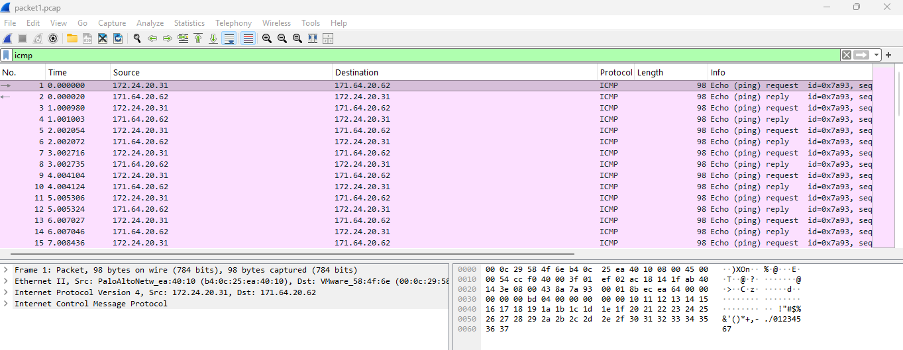
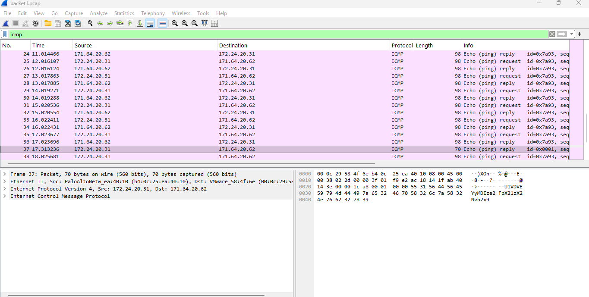
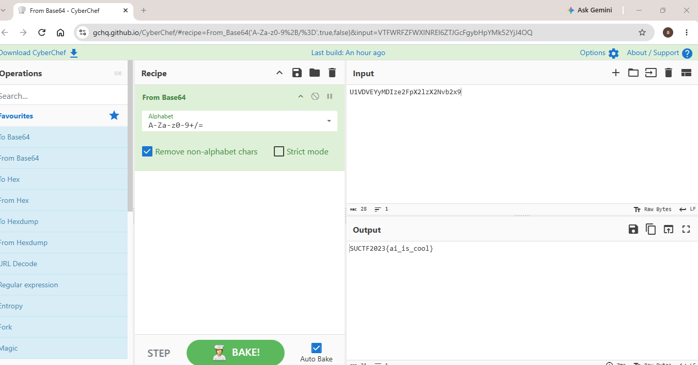

# 🔐 Vulnerability Analysis — Lab 7

## Question 1 — Analyse packet1.pcap and Find the Flag

### Objective
Identify a hidden flag embedded inside ICMP packet payloads using Wireshark.

---

### Step 1 — Open the File in Wireshark

Launch Wireshark and go to **File → Open**, then select `packet1.pcap`.

---

### Step 2 — Identify the Protocol

After loading, inspect the packet list. All **41 packets** use **ICMP** (Internet Control Message Protocol) — Echo Request (Type 8) and Echo Reply (Type 0) between two hosts.

| Field | Value |
|-------|-------|
| Source IP | `172.24.20.31` |
| Destination IP | `171.64.20.62` |
| Protocol | ICMP (Echo Request / Echo Reply) |
| Total Packets | 41 |

---

### Step 3 — Apply ICMP Filter and Inspect Payloads

Type `icmp` in the Wireshark display filter bar and press Enter.

Browse each packet and expand the **Data** section in the Packet Details pane. Most packets carry standard repeating ping padding — nothing unusual.



---

### Step 4 — Spot the Anomalous Packet (Packet 37)

**Packet 37**, an ICMP Echo Reply (Type 0), stands out. Its payload contains a readable ASCII string instead of normal ping padding — a technique known as an **ICMP Covert Channel**.



```
U1VDVEYyMDIze2FpX2lzX2Nvb2x9
```

> An attacker embeds data inside ICMP payloads to exfiltrate information without triggering obvious firewall alerts.

---

### Step 5 — Decode the Payload (Base64)

The string is **Base64-encoded**. Decode it using [CyberChef](https://gchq.github.io/CyberChef/) with the **From Base64** operation.



---

### 🚩 Flag

```
SUCTF2023{ai_is_cool}
```

---

## Question 2 — Analyse packet2.pcap and Find the Flag

### Objective
Analyse a multi-protocol capture, extract a hidden file transferred over FTP, and decode a Pigpen cipher to recover the flag.

---

### Traffic Overview

| # | Protocol / Port | Details |
|---|----------------|---------|
| 1 | ICMP (668 packets) | Standard ping traffic `172.24.20.31 → 171.64.20.62`. No flag here. |
| 2 | TCP Port 4444 | WarGames movie-reference chat conversation. |
| 3 | FTP Port 21 | Client downloaded `global_thermonuclear_war.gamerules.txt` via PASV mode. |
| 4 | TCP Ports 8888–10112 | Additional WarGames tic-tac-toe dialogue. |

---

### Step 1 — Open packet2.pcap in Wireshark

Load the file and note the mix of protocols: ICMP, raw TCP chat, and FTP.

---

### Step 2 — Filter FTP Traffic

Apply the display filter `ftp or ftp-data` to isolate FTP packets. A PASV-mode file transfer for `global_thermonuclear_war.gamerules.txt` is visible.

---

### Step 3 — Follow the TCP Stream

Right-click any **FTP-DATA** packet → **Follow → TCP Stream**. The file content is revealed:


```
https://tinyurl.com/yr5zprz4
```

---

### Step 4 — Visit the URL

The shortened URL redirects to a **Google Doc titled "Club Tux"**, which contains images of **Pigpen cipher** symbols — a substitution cipher that encodes letters using tic-tac-toe grid fragments and X-shapes.


---

### Step 5 — Decode the Pigpen Cipher

Navigate to [dCode.fr — Tic-Tac-Toe Cipher](https://www.dcode.fr/tic-tac-toe-cipher) and input the symbols from the Google Doc.


---

### 🚩 Flag

```
SUCTF2023{EXMACHINAAVA}
```


---

## Question 3 — Interpret an Nmap Output

### Scanned Target Overview

| Port | State | Service | Version |
|------|-------|---------|---------|
| 21/tcp | open | FTP | vsftpd 2.3.4 |
| 22/tcp | open | SSH | OpenSSH 5.3p1 |
| 80/tcp | open | HTTP | Apache 2.2.8 |
| 139/tcp | open | NetBIOS-SSN | — |
| 445/tcp | open | SMB | Windows 7 Professional 7601 SP1 |

---

### 1. What can an attacker do with each port?

| Port | Service | Potential Attacks |
|------|---------|-------------------|
| 21/tcp | FTP (vsftpd 2.3.4) | Anonymous login, file upload/download, backdoor shell trigger, credential sniffing (unencrypted), brute-force |
| 22/tcp | SSH (OpenSSH 5.3p1) | Brute-force logins (Hydra), user enumeration via timing differences, exploitation of old SSH bugs |
| 80/tcp | HTTP (Apache 2.2.8) | Directory enumeration (Gobuster/Dirb), SQLi, XSS, file inclusion, outdated Apache module exploits |
| 139/tcp | NetBIOS-SSN | Share and user enumeration, NTLM hash capture, relay attacks |
| 445/tcp | SMB (Win7 SP1) | EternalBlue unauthenticated RCE, pass-the-hash, ransomware deployment, lateral movement |

---

### 2. What vulnerabilities are likely present based on the version?

| Port | Version | CVE / Vulnerability | Severity |
|------|---------|--------------------|-|
| 21 | vsftpd 2.3.4 | **CVE-2011-2523** — Backdoor opens a root shell on port 6200 when `:)` is appended to the username | CVSS 10.0 |
| 22 | OpenSSH 5.3p1 | **CVE-2018-15473** — User enumeration via differing server responses; brute-force susceptibility | Medium |
| 80 | Apache 2.2.8 | **CVE-2007-6750** (Slowloris DoS), **CVE-2017-7679** (mod_mime buffer overflow) | High |
| 445 | Windows 7 SP1 | **CVE-2017-0144 (EternalBlue / MS17-010)** — Unauthenticated SMB Remote Code Execution | CVSS 9.3 |

---

### 3. Which one is the highest risk and why?

> ⚠️ **Highest Risk: Port 445 — SMB / EternalBlue (MS17-010)**  
> Closely followed by **Port 21 — vsftpd 2.3.4 backdoor**

**Reasoning:**
- MS17-010 allows **unauthenticated RCE at SYSTEM privilege** — no credentials required whatsoever.
- Weaponised in **WannaCry** and **NotPetya**, two of the most destructive ransomware attacks in history.
- Windows 7 SP1 reached **End-of-Life in January 2020** — no patches available from Microsoft.
- Automated exploit tools freely available via Metasploit (`exploit/windows/smb/ms17_010_eternalblue`).
- vsftpd's backdoor carries a **CVSS of 10.0** and grants direct root shell access on Linux — a dangerous runner-up.

---

### 4. What attack path can be built from this?

#### Path A — EternalBlue (Primary, Most Impactful)
1. Confirm vulnerability: `nmap --script smb-vuln-ms17-010 -p 445 <target>`
2. Launch Metasploit: `use exploit/windows/smb/ms17_010_eternalblue`
3. Set `RHOSTS` and `run` → obtain a **SYSTEM-level Meterpreter shell**

#### Path B — vsftpd Backdoor (Backup)
1. Connect to FTP and use any username with `:)` appended (e.g., `anonymous:)`)
2. The backdoor triggers and opens a root shell on **port 6200**
3. Connect with `nc <target> 6200` → full root/admin access

---

### 5. What should be the remediation?

| Area | Recommended Action |
|------|--------------------|
| OS Upgrade | Migrate from Windows 7 EOL to Windows 10/11 or Server 2019/2022. Apply MS17-010 patch (KB4012212) if immediate migration isn't possible. |
| Patch Management | Update vsftpd, OpenSSH, and Apache to their latest stable versions immediately. |
| Disable SMBv1 | Run: `Set-SmbServerConfiguration -EnableSMB1Protocol $false`. SMBv1 is legacy and actively exploited. |
| Firewall Rules | Block ports 21, 22, 139, 445 from the public internet. Restrict to trusted IPs or VPN-only access. |
| Network Monitoring | Deploy IDS/IPS (e.g., Snort) with signatures for EternalBlue and vsftpd backdoor activity. |

---

## Question 4 — Identify the OS (OS Fingerprinting) - TTL

### Concept: Time To Live (TTL)

Each operating system sets a **default TTL** value in ICMP packets. By observing the TTL in a ping reply, analysts can infer the underlying OS without any active port scanning.

| TTL Value | Operating System / Device |
|-----------|--------------------------|
| **64** | Linux / Unix-based systems (e.g., Ubuntu, Debian, CentOS) |
| **128** | Windows operating systems (e.g., Windows 7, 10, Server) |
| **255** | Network devices (Cisco routers/switches) or Solaris Unix |

> **Note:** Every router hop along the path decrements the TTL by 1. If you observe `ttl=62` instead of 64, it means the packet passed through 2 routers. Analysts account for this decrement when inferring the original OS.

---

### Image 1


**Answer:** `ttl=64` → **Linux / Unix-based OS**

---

### Image 2


**Answer:** `Time to live: 255` → **Cisco Router/Switch or Solaris Unix**

---

### Image 3


**Answer:** `ttl=128` → **Windows OS**

---

## Question 5 — Analyse the Nessus File

**File:** `Network_Scan.nessus`  
**Vulnerability:** **Ghostcat (CVE-2020-1938)**

---

### 1. What is the affected port number?

| Port | Service |
|------|---------|
| **8009/tcp** | Apache JServ Protocol (AJP) connector on Apache Tomcat |

---

### 2. What is the affected protocol?

**AJP13 over TCP** — the binary protocol Tomcat uses to accept proxied requests from a front-end web server (e.g., Apache httpd with `mod_jk`).

---

### 3. What is the CVSS Score?

| Metric | Score |
|--------|-------|
| CVSSv3 Base Score | **9.8 (Critical)** |
| CVSSv3 Temporal Score | 8.8 |
| CVSSv3 Vector | `AV:N/AC:L/PR:N/UI:N/S:U/C:H/I:H/A:H` |
| CVSSv2 Base Score | 7.5 (High) |
| VPR Score | 9.6 |

> The vector `AV:N/AC:L/PR:N/UI:N` means: exploitable over the **Network**, **Low** complexity, **No credentials** required, **No user interaction** — a worst-case scenario.

---

### 4. Can you find any exploit related to this vulnerability?

| Source | Details |
|--------|---------|
| ExploitDB EDB-ID 48143 | Public Python PoC enabling file-read against any exposed AJP port |
| Metasploit | `auxiliary/admin/http/tomcat_ghostcat` — automated exploitation module |
| GitHub PoCs | Demonstrate LFI (Local File Inclusion); if file upload enabled, escalates to RCE |
| CNVD-2020-10487 | Original Chinese NVD disclosure accompanying the public PoC release |

---

### 5. Find the CVE for this vulnerability

**CVE-2020-1938**

| Field | Details |
|-------|---------|
| Published | 20 February 2020 |
| Affected Versions | Apache Tomcat < 9.0.31, < 8.5.51, < 7.0.100 |
| Fix — Upgrade | Update to Tomcat 9.0.31+, 8.5.51+, or 7.0.100+ |
| Fix — Disable AJP | If AJP is not needed, remove/comment the AJP Connector in `server.xml` |
| Fix — Restrict Access | If AJP must stay active, bind to `address="127.0.0.1"` and set a `secret` attribute |
